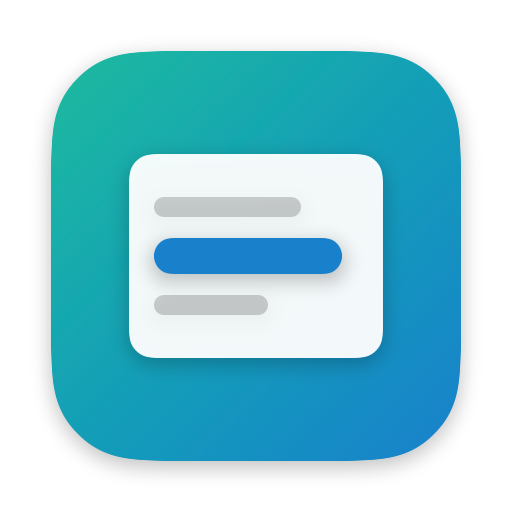
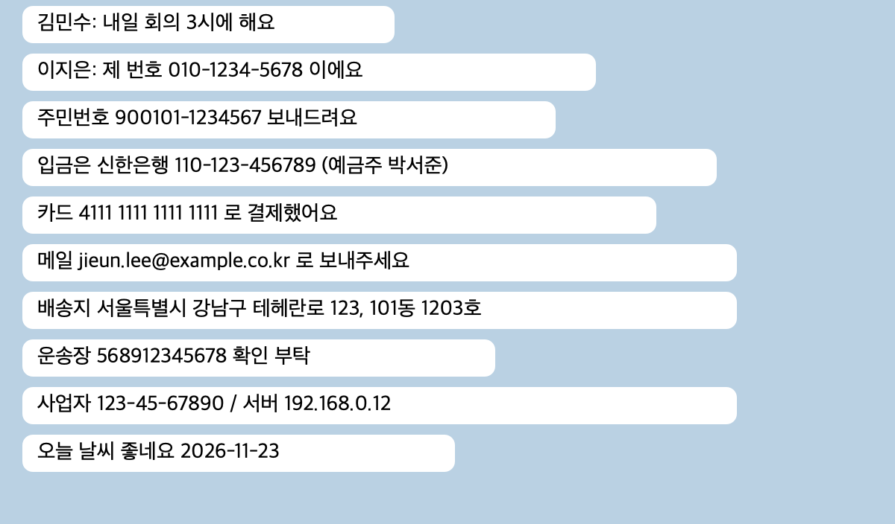
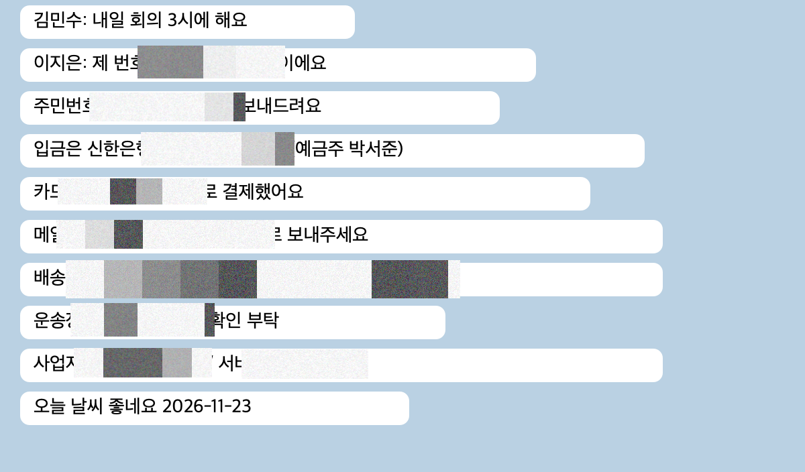
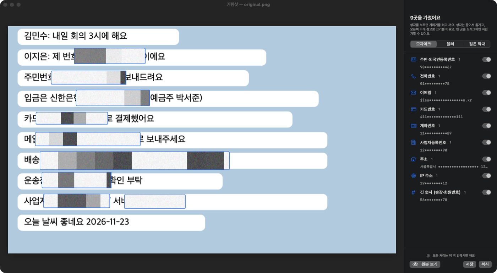

<h1 align="center">가림샷 (GarimShot)</h1>

<b>캡처하면 개인정보가 저절로 가려지는 맥 앱.</b> 주민번호, 전화번호, 계좌, 카드, 주소, 얼굴까지. 찍는 순간 찾아서 모자이크해 줘요. 모든 처리는 내 맥 안에서만 해요.

<a href="https://github.com/tmdghks-dev/garimshot/releases/latest/download/GarimShot.dmg"><b>⬇︎ GarimShot.dmg 받기</b></a> · <a href="https://tmdghks.dev/garimshot/">소개 페이지</a> · <a href="https://github.com/tmdghks-dev/garimshot/issues/new">의견 남기기</a>

macOS 14 이상 · Apple Silicon / Intel · 베타 기간 무료

| 캡처한 그대로 | 가림샷이 가린 결과 |
|---|---|
|  |  |

예시 이미지는 테스트용으로 만든 가짜 대화예요.

## 무엇을 가려 주나요
- 주민·외국인등록번호, 전화번호, 이메일
- 카드번호, 계좌번호 (은행 이름 주변 인식)
- 사업자등록번호, 여권번호, 운전면허번호
- 도로명·지번 주소, IP 주소, API 키
- 송장 같은 긴 숫자, 얼굴과 프로필 사진

## 쓰는 법
- **⌃⇧4** 로 영역을 캡처하면 바로 가려진 편집 창이 열려요. 스페이스바를 누르면 창 단위로 찍혀요.
- 가리는 방식은 **모자이크 · 블러 · 검은 막대** 중에서 골라요.
- 가림 상자는 눌러서 켜고 끄고, 끌어서 옮기고, 모서리로 크기를 바꿔요. 빈 곳을 드래그하면 직접 가릴 수 있어요.
- 이미 있는 사진도 돼요. 메뉴의 **사진 불러와서 가리기**, 메뉴 막대 아이콘에 끌어다 놓기, 클립보드 이미지 가리기.
- ⌘C 로 복사해서 카톡·슬랙에 바로 붙여 넣으세요.

## 설치
1. [GarimShot.dmg](https://github.com/tmdghks-dev/garimshot/releases/latest/download/GarimShot.dmg)를 열고 **가림샷**을 Applications 폴더로 끌어 놓아요.
2. 처음 열 때 "확인할 수 없음" 경고가 뜨면 **시스템 설정 → 개인정보 보호 및 보안** 맨 아래의 **그래도 열기**를 눌러요. 아직 Apple 공증 전인 베타라 처음 한 번만 필요해요.
3. 처음 캡처할 때 **화면 및 시스템 오디오 녹음** 권한을 켜 주세요. 켠 뒤 앱을 한 번 다시 열면 돼요.

## 안전하게 가리나요?
- 원본 픽셀을 덮어써요. 모자이크 칸은 글자보다 크게, 매번 무작위 잡음을 섞어서 숫자를 하나씩 대입해 맞히기 어렵게 했어요. 가장 확실한 건 검은 막대예요.
- 가리는 중 오류가 나면 원본을 복사하거나 저장하지 않아요.
- 이미지는 인터넷으로 보내지 않아요. 글자 인식도 맥에 내장된 기능(Vision)으로 해요.

## 의견 보내기
놓친 개인정보, 잘못 가린 곳, 원하는 기능을 [Issues](https://github.com/tmdghks-dev/garimshot/issues/new)에 남겨 주세요. 캡처를 첨부할 때는 개인정보를 꼭 가린 뒤 올려 주세요.
